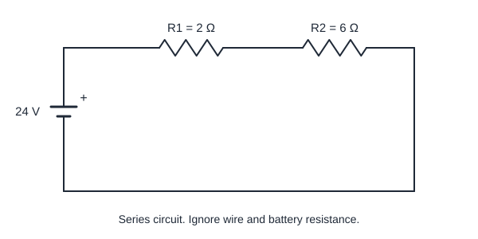

<!-- nav:top -->
[Contents](../../README.md#contents) · Previous: [Electronics, PLCs and test instruments](electronics-plc-instruments.md) · Next: [How scoring works](../scoring.md)
<!-- /nav:top -->

# AC/DC theory, power distribution and electrical maintenance

**In one line:** you apply Ohm's law and the power formula to series and parallel circuits, read voltages around a simple circuit to find a fault, and know the basics of transformers, breakers and grounding.

This is a MultiCraft category. Both MultiCrafTest and MultiCraft Trainee list "Basic AC/DC Theory, Power Distribution, and Electrical Maintenance". Ramsay's MultiCraft Trainee sample question asks what electrical resistance is measured in, which shows the level: core theory, applied to plant equipment.

## What it measures

- **Circuit theory.** Ohm's law, series and parallel resistance, power.
- **Fault finding with a meter.** Where you should and should not read voltage in a working or faulty circuit.
- **Distribution.** Transformers, three-phase voltages, breakers and fuses.
- **Electrical maintenance and safety.** Grounding, overcurrent, and what a trip tells you.

## How the questions look

Four-option multiple choice. Many items give a small circuit with round numbers and ask for a current, voltage, resistance or power. Others describe a fault and ask for the cause.

## A method that works

1. **Write the three formulas before you start:** V = I x R, P = V x I, and for parallel resistors 1 / Rt = 1 / R1 + 1 / R2 + ...
2. **For series circuits, add the resistances,** find the one current, then find each voltage drop.
3. **For parallel circuits, every branch has the full supply voltage.** Find each branch current, then add them.
4. **For voltage fault finding, remember:** an open switch or open fuse has the full supply voltage across it, and a closed switch or good wire has about zero.
5. **For transformers, voltage follows the turns ratio.** A 4:1 step-down transformer divides the voltage by 4.

## Traps that cost points

- **Adding parallel resistors like series ones.** Parallel resistance is always lower than the smallest branch.
- **Expecting zero volts across an open switch.** With a good load beyond it, the full supply appears across the open contacts.
- **Confusing an overload with a short circuit.** A breaker that trips the instant you reset it points to a short or ground fault, not a heavy load.
- **Mixing up the grounding conductor and the neutral.** The neutral carries normal current. The equipment ground carries fault current only, so the breaker trips.
- **Forgetting the square root of 3** between line and phase voltages in a wye system: 208 / 1.732 is about 120.

## Timing

Calculation items: 45 seconds to a minute. Knowledge items: 20 to 30 seconds.

## Practice items

These items are original, written for these notes. They are not taken from any Ramsay test.

**Item 1.** In the series circuit above, what current flows?

- A. 2 A
- B. 3 A
- C. 4 A
- D. 12 A

**Item 2.** What is the total resistance of the three resistors in parallel?

- A. 10 Ω
- B. 20 Ω
- C. 33 Ω
- D. 100 Ω

**Item 3.** In the circuit above the switch is open. What does a voltmeter read between points 2 and 3, across the open switch?

- A. 0 V
- B. 60 V
- C. 120 V
- D. 240 V

**Item 4.** A breaker trips the instant it is reset, with the load switched on. What is the most likely cause?

- A. A short circuit or ground fault downstream
- B. The circuit is lightly loaded
- C. The room is cold
- D. The wire run is long

**Item 5.** What is the main purpose of the equipment grounding conductor?

- A. To carry the normal return current
- B. To give fault current a low-resistance path so the breaker or fuse opens
- C. To raise the supply voltage
- D. To reduce the power bill

Answers and explanations, items 1 to 5

**Item 1: B, 3 A.** Series resistance adds: 2 + 6 = 8 Ω. I = V / R = 24 / 8 = 3 A. *Why not D:* 12 A uses only the 2 Ω resistor.

**Item 2: A, 10 Ω.** 1 / Rt = 1/40 + 1/40 + 1/20 = 0.025 + 0.025 + 0.05 = 0.1, so Rt = 10 Ω. *Why not D:* 100 Ω adds the resistors as if they were in series.

**Item 3: C, 120 V.** Point 2 connects to L1 through the good fuse. Point 3 connects to N through the good lamp, because no current flows so the lamp drops no voltage. The open switch has the full 120 V across it. *Why not A:* zero would be the reading across a closed switch.

**Item 4: A.** An instant trip on reset means a very high current, which is what a short circuit or ground fault produces. *Why not B:* a light load draws less current, not more.

**Item 5: B.** If a live wire touches a metal enclosure, the equipment ground carries the fault current back so the overcurrent device opens quickly, and the enclosure does not stay live. *Why not A:* normal return current is the neutral's job.

Want more? The [free timed Ramsay Maintenance practice test on PrepClubs](https://prepclubs.com/free-practice-tests/ramsay-maintenance?utm_source=github&utm_medium=referral&utm_campaign=5q2ftk&utm_content=ramsay-maintenance) has the full 60 questions, scored by area, in the MecTest style. MultiCraft-style forms with motors, electronics and AC/DC theory are there too.

## Score yourself

| Item | 1 | 2 | 3 | 4 | 5 |
|---|---|---|---|---|---|
| Answer | B | A | C | A | B |

- **5:** strong. Move on.
- **3 to 4:** redo the parallel circuit and the voltage fault-finding items, which is where most marks go.
- **2 or fewer:** drill V = I x R and P = V x I on simple numbers until you can do them without writing.

## Next step

Practise circuit sums against the clock in the [free Ramsay Maintenance practice test on PrepClubs](https://prepclubs.com/free-practice-tests/ramsay-maintenance?utm_source=github&utm_medium=referral&utm_campaign=5q2ftk&utm_content=ramsay-maintenance).

---

<!-- nav:bottom -->
← Previous: [Electronics, PLCs and test instruments](electronics-plc-instruments.md) | Next: [How scoring works](../scoring.md) → | [Back to contents](../../README.md#contents)
<!-- /nav:bottom -->
