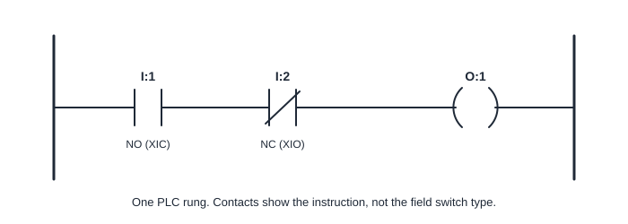
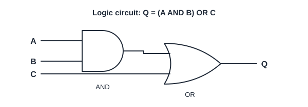

<!-- nav:top -->[Contents](../../README.md#contents) · Previous: [Motors, control circuits and schematics](motors-controls.md) · Next: [AC/DC theory and power distribution](ac-dc-power-distribution.md)<!-- /nav:top -->

# Electronics, PLCs and test instruments

**In one line:** you read simple PLC ladder logic and logic gates, know what common electronic parts do in a power supply, convert binary and 4-20 mA signals, and use a meter safely.

This is a MultiCraft category. MultiCrafTest lists "Digital Electronics, Power Supplies, Computers & PLC, and Test Instruments". MultiCraft Trainee lists "Digital & Analog Electronics, Power Supplies, Computers & PLC, and Test Instruments". Ramsay's MultiCrafTest sample question is about microprocessor stages, so expect some board-level electronics on that form. Ramsay notes that its Maintenance Troubleshooter test is an alternative for employers who do not need board-level electronics.

## What it measures

Automated machines run on PLCs, sensors and power supplies. A multicraft technician needs enough electronics to tell a bad input from a bad program:

- **PLC logic.** Reading contacts and coils, and knowing how the scan works.
- **Digital basics.** Logic gates and binary numbers.
- **Analog signals.** 4-20 mA loops and scaling.
- **Power supplies.** Rectifiers, filter capacitors, regulators.
- **Test instruments.** Measuring volts, amps and ohms the right way.

## How the questions look

Four-option multiple choice. Expect a PLC rung or logic gate drawing to evaluate, a number conversion, a scaling sum, and short questions on parts and meters.

## A method that works

1. **For PLC rungs, separate the field device from the instruction.** An examine-if-closed (XIC) instruction is true when its input bit is 1. An examine-if-open (XIO) instruction is true when its input bit is 0. The wiring of the switch decides the bit.
2. **For gates, write a truth row.** Put 1s and 0s on every input and work forward one gate at a time.
3. **For binary, use place values** 8, 4, 2, 1 from the left in a 4-bit number, and add the ones that have a 1.
4. **For 4-20 mA, subtract the 4 first.** The span is 16 mA. Percentage of range = (reading - 4) / 16.
5. **For meters, picture where the meter sits.** Volts across the part, amps in series with it, ohms only with power off.

## Traps that cost points

- **Treating XIO as "normally closed switch".** It is an instruction about the bit, not a description of the wiring. A normally closed stop button wired to an input makes the bit 1 when nobody presses it.
- **Forgetting the 4 mA offset.** 12 mA is 50% of range, not 60%.
- **Putting an ammeter across a supply.** An ammeter has almost no resistance. Across a supply, it is a short circuit.
- **Measuring resistance on a live circuit.** The reading is wrong and the meter can be damaged.
- **Reading binary from the wrong end.** The leftmost bit carries the largest value.

## Timing

Most items: 30 to 45 seconds. Gate and scaling items: up to a minute.

## Practice items

These items are original, written for these notes. They are not taken from any Ramsay test.

**Item 1.** In the rung above, when is output O:1 on?

- A. When I:1 and I:2 are both on
- B. When I:1 is on and I:2 is off
- C. When I:1 is off and I:2 is on
- D. When either input is on

**Item 2.** Input I:2 is wired to a normally closed stop button. Nobody is pressing it, so the input is energised. I:1 is on. Is O:1 on?

- A. Yes, because the stop button is not pressed
- B. No, because the I:2 instruction is false while the input is energised
- C. It switches on and off every scan
- D. It depends on the scan time

**Item 3.** In the logic circuit above, which set of inputs makes Q = 1?

- A. A = 1, B = 0, C = 0
- B. A = 0, B = 1, C = 0
- C. A = 1, B = 1, C = 0
- D. A = 0, B = 0, C = 0

**Item 4.** What is the binary number 1011 in decimal?

- A. 9
- B. 10
- C. 11
- D. 13

**Item 5.** What does a bridge rectifier do in a power supply?

- A. Converts AC to DC
- B. Converts DC to AC
- C. Steps the voltage up
- D. Filters out radio interference

Answers and explanations, items 1 to 5

**Item 1: B.** I:1 is examine-if-closed, true when its bit is 1. I:2 is examine-if-open, true when its bit is 0. They are in series, so both must be true: I:1 on and I:2 off. *Why not A:* with I:2 on, its XIO instruction is false and breaks the rung.

**Item 2: B.** The normally closed button passes current while not pressed, so the I:2 bit is 1. An XIO instruction on a bit that is 1 is false, so the rung is broken and O:1 stays off. This is why stop buttons wired normally closed are usually programmed with XIC. *Why not A:* that answer confuses the button's wiring with the instruction.

**Item 3: C.** Q = (A AND B) OR C. With A = 1 and B = 1, the AND output is 1, so Q = 1. *Why not A:* with B = 0 the AND output is 0, and C = 0, so Q = 0.

**Item 4: C, 11.** Place values 8, 4, 2, 1: 1 x 8 + 0 x 4 + 1 x 2 + 1 x 1 = 11. *Why not D:* 13 would be 1101.

**Item 5: A.** Four diodes steer both halves of the AC wave the same way, giving pulsing DC. *Why not D:* a rectifier does not filter. A capacitor after it smooths the ripple.

**Item 6.** In a DC power supply, what is the main job of the large capacitor after the rectifier?

- A. Smoothing the ripple in the DC output
- B. Turning DC back into AC
- C. Limiting the output current
- D. Raising the frequency

**Item 7.** A pressure transmitter has a range of 0 to 200 psi and a 4-20 mA output. It is sending 12 mA. What is the pressure?

- A. 60 psi
- B. 100 psi
- C. 120 psi
- D. 150 psi

**Item 8.** How is a multimeter connected to measure the current through a load?

- A. In parallel with the load
- B. In series with the load
- C. Between the load and ground, with power off
- D. Across the supply terminals

**Item 9.** Before you measure the resistance of a heater element with an ohmmeter, what must you do?

- A. Turn the power on so current flows
- B. Remove power from the circuit
- C. Set the meter to AC volts
- D. Connect the meter in series with the supply

**Item 10.** In what order does a typical PLC scan run?

- A. Update outputs, read inputs, run program
- B. Read inputs, run program, update outputs
- C. Run program, read inputs, update outputs
- D. All three happen at the same time

Answers and explanations, items 6 to 10

**Item 6: A.** The filter capacitor charges on each peak and feeds the load between peaks, smoothing the pulsing DC. *Why not C:* current limiting is done by a regulator or fuse, not the filter capacitor.

**Item 7: B, 100 psi.** (12 - 4) / 16 = 0.5, so 50% of 200 psi = 100 psi. *Why not C:* 120 psi comes from 12 / 20 x 200, which ignores the 4 mA offset.

**Item 8: B.** Current must pass through the meter, so the circuit is opened and the meter placed in series. *Why not A:* connected in parallel, the low-resistance ammeter becomes a short across the load.

**Item 9: B.** An ohmmeter supplies its own small current. Outside voltage gives a false reading and can damage the meter. *Why not D:* that is how you measure current, not resistance.

**Item 10: B.** The PLC reads all inputs into memory, runs the program against that snapshot, then writes the outputs, and repeats. *Why not D:* the steps run one after another, which is why a very short input pulse can be missed between scans.

## Score yourself

| Item | 1 | 2 | 3 | 4 | 5 | 6 | 7 | 8 | 9 | 10 |
|---|---|---|---|---|---|---|---|---|---|---|
| Answer | B | B | C | C | A | A | B | B | B | B |

- **9 to 10:** strong. Move on.
- **6 to 8:** redo the PLC items and the 4-20 mA sum until the "instruction versus wiring" rule is automatic.
- **5 or fewer:** start with binary, gates and meter placement, which are quick wins, then return to the PLC items.

## Next step

Test PLC and instrument items at pace in the [free Ramsay Maintenance practice test on PrepClubs](https://prepclubs.com/free-practice-tests/ramsay-maintenance?utm_source=github&utm_medium=referral&utm_campaign=study-notes&utm_content=ramsay-maintenance).

---

<!-- nav:bottom -->← Previous: [Motors, control circuits and schematics](motors-controls.md) | Next: [AC/DC theory and power distribution](ac-dc-power-distribution.md) → | [Back to contents](../../README.md#contents)<!-- /nav:bottom -->
