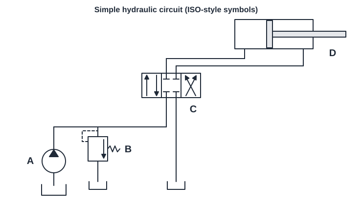
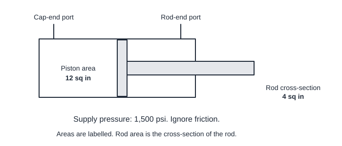
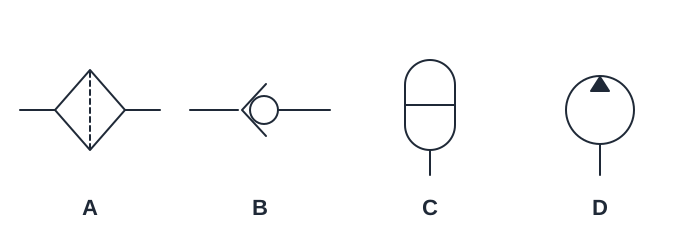
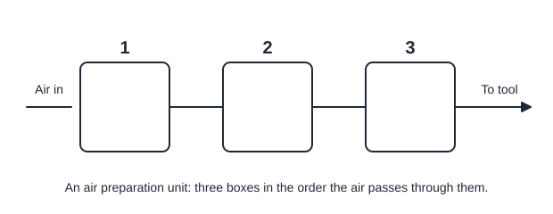

<!-- nav:top -->[Contents](../../README.md#contents) · Previous: [15-minute diagnostic](../diagnostic.md) · Next: [Welding and rigging](welding-rigging.md)<!-- /nav:top -->

# Hydraulics and pneumatics

**In one line:** you read fluid power circuits, work out forces and speeds from pressure and area, and know what each valve, pump and actuator does.

Hydraulics and pneumatics is a scored category on MecTest, MultiCrafTest, MultiCraft Trainee and Mechanical Maintenance Trainee, so you will meet it whichever of these forms you sit. Ramsay's own MecTest sample question is a hydraulics item, which tells you the topic is treated as core maintenance knowledge.

## What it measures

Whether you can keep a plant's hydraulic presses, lifts and air tools running. In practice that means three skills:

- **Reading symbols and circuits.** Knowing a relief valve from a check valve on a drawing, and following oil from the pump to the cylinder and back to tank.
- **Doing the basic sums.** Force equals pressure times area. Speed depends on flow and area. These two rules answer most calculation items.
- **Diagnosing faults.** Noise, heat, slow cylinders and pressure loss each point to a short list of causes.

## How the questions look

Short multiple-choice items with four options. Some are plain knowledge questions ("what does an accumulator do?"). Others show a circuit or a component drawing and ask you to identify a part, predict what happens, or calculate a force. Calculation items use round numbers, so if your answer is messy, recheck the method.

## A method that works

1. **Name every component first.** Pump, relief valve, directional valve, actuator, tank. Point at each one before you read the options.
2. **Trace the flow.** Start at the pump, follow the pressure line, and ask where oil can go in the valve position shown.
3. **For force, use F = P x A.** Pressure in psi times area in square inches gives pounds. On the retract stroke, use the piston area minus the rod area.
4. **For speed, think "smaller area, faster".** The same flow into a smaller area moves the piston further per second.
5. **For faults, ask what changed.** Heat, noise and slowness usually come from the suction side, the relief valve or internal leakage.

## Traps that cost points

- **Using full piston area on retract.** The rod takes up part of the piston face on the rod side. Subtract it.
- **Thinking the pump makes pressure.** A pump makes flow. Pressure comes from resistance to that flow, and the relief valve sets the ceiling.
- **Confusing the relief valve with the directional valve.** The directional valve chooses where oil goes. The relief valve limits how high pressure can rise.
- **Forgetting air compresses.** Pneumatic cylinders are fast and clean but soft. They do not hold a mid-stroke position as firmly as hydraulics.
- **Missing the suction side.** Cavitation, noise and a starved pump usually start before the pump, at a clogged strainer or a low reservoir.

## Timing

Knowledge items should take 20 to 40 seconds. Allow about a minute for a circuit or calculation item. If a circuit drawing does not make sense after a minute, eliminate the options that are clearly about other components and move on.

## Practice items

These items are original, written for these notes. They are not taken from any Ramsay test.

**Item 1.** In the circuit above, which component sets the maximum pressure the system can reach?

- A. A
- B. B
- C. C
- D. D

**Item 2.** The directional valve (C) is shown in its centre position, where all four ports are blocked. With the pump running, what does the cylinder (D) do?

- A. It extends slowly
- B. It retracts slowly
- C. It holds its position
- D. It floats and can be pushed by hand

**Item 3.** Using the cylinder above, what force does the rod push out with when 1,500 psi is applied to the cap end?

- A. 6,000 lb
- B. 12,000 lb
- C. 18,000 lb
- D. 24,000 lb

**Item 4.** Using the same cylinder, what force does it pull with when 1,500 psi is applied to the rod end?

- A. 6,000 lb
- B. 12,000 lb
- C. 18,000 lb
- D. 24,000 lb

**Item 5.** The pump sends the same flow to the cylinder on both strokes. Which stroke is faster?

- A. Extend, because the piston face is larger
- B. Retract, because the oil fills a smaller area
- C. Both are the same, because the flow is the same
- D. It depends only on the pressure setting

Answers and explanations, items 1 to 5

**Item 1: B.** B is a relief valve: a box with an offset arrow, a spring and a dashed pilot line, piped from the pressure line to tank. When pressure reaches the spring setting, it opens and dumps flow to tank. *Why not C:* the directional valve decides where oil goes, not how high the pressure can rise.

**Item 2: C.** With all ports blocked, oil cannot enter or leave either end of the cylinder, so it is hydraulically locked in place. Pump flow goes over the relief valve to tank. *Why not D:* a "float" centre connects both cylinder ports to tank. This centre blocks them.

**Item 3: C, 18,000 lb.** Force equals pressure times area: 1,500 psi x 12 sq in = 18,000 lb. *Why not B:* 12,000 lb uses the rod-side area, which applies only when retracting.

**Item 4: B, 12,000 lb.** On the rod side, the rod covers 4 sq in of the piston, leaving 12 - 4 = 8 sq in. 1,500 x 8 = 12,000 lb. *Why not A:* 6,000 lb comes from multiplying by the rod area alone, which is the part oil cannot push on.

**Item 5: B.** The rod side holds less oil per inch of travel (8 sq in against 12 sq in), so the same flow moves the piston faster on retract. *Why not C:* the same flow only gives the same speed when the areas match.

**Item 6.** Which symbol above is an accumulator?

- A. A
- B. B
- C. C
- D. D

**Item 7.** Which symbol above lets fluid flow one way and blocks it the other way?

- A. A
- B. B
- C. C
- D. D

**Item 8.** A hydraulic pump has become noisy, with a sound like gravel passing through it, and the pressure gauge flickers. Which is the most likely cause?

- A. A clogged suction strainer
- B. The relief valve set slightly too high
- C. An oversized return line
- D. A worn cylinder rod wiper

**Item 9.** The air preparation unit above is a standard filter, regulator and lubricator set. Which unit is normally in position 3?

- A. Filter
- B. Regulator
- C. Lubricator
- D. Air dryer

**Item 10.** Why is a pneumatic cylinder a poor choice for holding a load firmly at a precise point partway along its stroke?

- A. Air is compressible
- B. Air is heavier than hydraulic oil
- C. Pneumatic systems run at higher pressure than hydraulics
- D. Pneumatic cylinders have no seals

Answers and explanations, items 6 to 10

**Item 6: C.** The tall capsule with a dividing line is the accumulator symbol: a vessel that stores fluid under pressure and releases it to meet peak demand or absorb shocks. *Why not D:* D is a pump, a circle with a solid triangle pointing outward.

**Item 7: B.** B is a check valve: a ball against a V-shaped seat. Flow in one direction lifts the ball off the seat; flow the other way presses it shut. *Why not A:* A is a filter, a diamond with a dashed line across it. It passes flow both ways.

**Item 8: A.** Gravel noise and an unsteady gauge are classic cavitation signs. The pump cannot fill on the suction side, so vapour bubbles form and collapse. A clogged strainer is the most common cause. *Why not B:* a high relief setting raises working pressure and heat, but does not starve the inlet.

**Item 9: C.** Air passes through the filter first (to remove dirt and water), then the regulator (to set pressure), then the lubricator (to add oil mist just before the tool). *Why not B:* the regulator sits in the middle, position 2.

**Item 10: A.** Air compresses and expands as the load or pressure changes, so the piston creeps and bounces. Oil is nearly incompressible, which is why hydraulics hold position well. *Why not C:* plant air usually runs at much lower pressure than hydraulics, not higher.

## Score yourself

| Item | 1 | 2 | 3 | 4 | 5 | 6 | 7 | 8 | 9 | 10 |
|---|---|---|---|---|---|---|---|---|---|---|
| Answer | B | C | C | B | B | C | B | A | C | A |

- **9 to 10:** solid. Keep this area warm with a few mixed items before test day.
- **6 to 8:** relearn the symbols you missed and redo the two force sums from scratch.
- **5 or fewer:** start with F = P x A and the five symbols on this page. Draw each one from memory until it sticks.

## Next step

Try hydraulics items mixed in with the other categories in the [free Ramsay Maintenance practice test on PrepClubs](https://prepclubs.com/free-practice-tests/ramsay-maintenance?utm_source=github&utm_medium=referral&utm_campaign=study-notes&utm_content=ramsay-maintenance), then come back to the traps list for anything you missed.

---

<!-- nav:bottom -->← Previous: [15-minute diagnostic](../diagnostic.md) | Next: [Welding and rigging](welding-rigging.md) → | [Back to contents](../../README.md#contents)<!-- /nav:bottom -->
