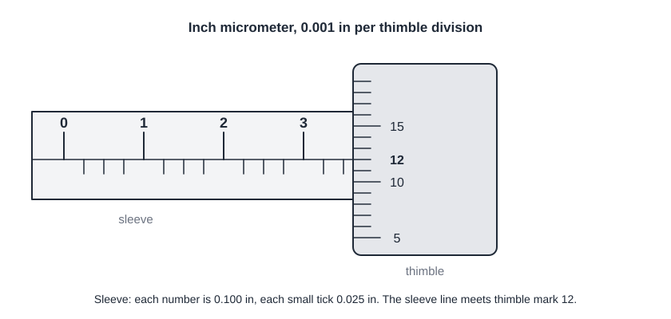

<!-- nav:top -->[Contents](../../README.md#contents) · Previous: [Print reading](print-reading.md) · Next: [Motors, control circuits and schematics](motors-controls.md)<!-- /nav:top -->

# Mechanical maintenance and shop tools

**In one line:** you show you can measure accurately, use hand and machine tools the right way, fit bearings, work safely under lockout, and think like a maintenance planner.

MecTest lists two categories here: Mechanical Maintenance, and Shop Machines, Tools & Equipment. Mechanical Maintenance Trainee lists Maintenance, and Shop Machines & Tools, Materials & Equipment. The MultiCraft forms fold both into their power transmission and maintenance category. Between them, these topics make up a large share of the mechanical content.

## What it measures

The everyday craft of a maintenance mechanic:

- **Precision measurement.** Reading micrometers, calipers, feeler gauges and dial indicators.
- **Tools and machines.** Correct use of hacksaws, drills, taps and torque wrenches, and safe speeds and feeds.
- **Repair practice.** Bearing removal and fitting, fasteners, and diagnosis from vibration and heat.
- **Safe work.** Lockout and tagout.
- **Maintenance strategy.** Preventive and predictive maintenance.

## How the questions look

Four-option multiple choice. Expect a measuring tool to read, short "which is the correct way" questions, and a few one-step calculations such as torque from force and wrench length.

## A method that works

1. **For a micrometer, read in three steps:** the largest sleeve number (each is 0.100 in), the small sleeve ticks showing past it (each 0.025 in), then the thimble line on the sleeve line (each 0.001 in). Add them.
2. **For "correct way" items, choose the option that protects the part and the person.** Pressing on the wrong ring, pushing a wrench or skipping lockout are classic wrong answers.
3. **For torque, multiply force by distance** from the centre of the bolt. Keep units consistent: pounds times feet gives pound-feet.
4. **For machine speed, remember: bigger cutter, slower rpm.** The cutting edge of a large drill travels further each turn.
5. **For diagnosis, link the symptom to one cause.** Vibration at running speed, heat after greasing, noise at start.

## Traps that cost points

- **Missing a sleeve tick on a micrometer.** That costs exactly 0.025 in and the wrong option will be waiting for you.
- **Pressing a bearing through the wrong ring.** Force must go through the ring that is being fitted, or it passes through the balls and dents the races.
- **Removing someone else's lock.** Under normal lockout rules only the person who applied a lock removes it.
- **Hacksaw blade fitted backwards.** Teeth point away from the handle so the saw cuts on the push stroke.
- **Confusing preventive with predictive.** Preventive work runs on a calendar or hour meter. Predictive work runs on measured condition, such as vibration or oil analysis.

## Timing

Most items: 20 to 40 seconds. Allow up to a minute for a measuring tool reading, and check your arithmetic once.

## Practice items

These items are original, written for these notes. They are not taken from any Ramsay test.

**Item 1.** What does the micrometer above read?

- A. 0.312 in
- B. 0.337 in
- C. 0.362 in
- D. 0.387 in

**Item 2.** You pull with 50 lb at the end of a wrench, 2 feet from the centre of the bolt. What torque do you apply?

- A. 25 lb-ft
- B. 52 lb-ft
- C. 100 lb-ft
- D. 1,200 lb-ft

**Item 3.** Which way should the teeth of a hacksaw blade point?

- A. Toward the handle, so it cuts on the pull stroke
- B. Away from the handle, so it cuts on the push stroke
- C. Either way, it makes no difference
- D. Up, away from the work

**Item 4.** Compared with a 1/4 in drill bit in the same steel, a 1 in drill bit should run at:

- A. A higher rpm
- B. A lower rpm
- C. The same rpm
- D. Whatever rpm the drill press is already set to

**Item 5.** Under normal lockout and tagout rules, who removes a lockout lock when the job is finished?

- A. The supervisor
- B. The operator of the machine
- C. The person who applied the lock
- D. Any qualified electrician

Answers and explanations, items 1 to 5

**Item 1: C, 0.362 in.** The largest sleeve number showing is 3, so 0.300. Two small ticks show past it: 0.050. The thimble reads 12 on the sleeve line: 0.012. 0.300 + 0.050 + 0.012 = 0.362 in. *Why not B:* 0.337 counts only one small tick.

**Item 2: C, 100 lb-ft.** Torque = force x distance = 50 lb x 2 ft = 100 lb-ft. *Why not D:* 1,200 multiplies by 24 inches but labels the result in pound-feet. 1,200 lb-in is the same torque as 100 lb-ft.

**Item 3: B.** A hacksaw cuts on the push stroke, so the teeth point away from the handle. *Why not A:* a backward blade drags, dulls quickly and can snap.

**Item 4: B.** The cutting edge of a large drill moves further each turn, so it needs a lower rpm to keep a sensible cutting speed. *Why not A:* high rpm on a large bit overheats and burns the cutting edges.

**Item 5: C.** Each person who works under lockout applies their own lock and is the only one who removes it, so nobody can be put at risk by someone else's decision. *Why not A:* lock removal by anyone else is allowed only under a special written procedure when the owner cannot be found, not as normal practice.

**Item 6.** You are pressing a ball bearing onto a shaft. Where should the press force be applied?

- A. On the outer ring
- B. On the inner ring
- C. On the cage
- D. Evenly on the inner and outer rings through the balls

**Item 7.** Why is a bearing often heated before being fitted onto a shaft?

- A. To soften the grease
- B. To expand the inner ring so it slides onto the shaft
- C. To harden the races
- D. To burn off the protective oil

**Item 8.** A dial indicator touches a rotating shaft. Over one full turn the needle moves from -0.002 in to +0.003 in. What is the total indicator reading (TIR)?

- A. 0.001 in
- B. 0.003 in
- C. 0.005 in
- D. 0.006 in

**Item 9.** A fan shows high vibration at exactly its running speed (1 x rpm), mostly in the radial direction. What is the most common cause?

- A. Unbalance
- B. A gear tooth defect
- C. A worn belt sheave groove
- D. Low supply voltage

**Item 10.** Which of these is predictive maintenance?

- A. Changing gearbox oil every 6 months whatever its condition
- B. Replacing a pump after it fails
- C. Trending bearing vibration monthly and planning a repair when it starts to rise
- D. Greasing all bearings on the first Monday of each month

**Item 11.** What is the standard tap drill size for a 1/2-13 UNC thread?

- A. 7/16 in
- B. 27/64 in
- C. 1/2 in
- D. 13/32 in

Answers and explanations, items 6 to 11

**Item 6: B.** The inner ring is the one being fitted onto the shaft, so the force must go straight through it. *Why not A:* pressing on the outer ring sends the force through the balls and dents the races, ruining the bearing.

**Item 7: B.** Heat expands the inner ring so it slides onto the shaft without force, then shrinks for a tight fit. *Why not C:* heating does not harden races, and too much heat softens them.

**Item 8: C, 0.005 in.** TIR is the full swing of the needle: from -0.002 to +0.003 is 0.005 in. *Why not B:* 0.003 is only the largest single reading, not the swing.

**Item 9: A.** Unbalance makes a once-per-turn force, so it shows up at exactly 1 x running speed, mainly radially. *Why not B:* gear defects show up at gear mesh frequency, which is the number of teeth times shaft speed.

**Item 10: C.** Predictive maintenance acts on measured condition. Trending vibration and planning the repair before failure is the textbook example. *Why not A:* a fixed-interval oil change is preventive maintenance.

**Item 11: B, 27/64 in.** 27/64 in (about 0.422 in) leaves enough material for roughly 75% thread depth in a 1/2-13 hole. *Why not A:* 7/16 in (0.4375) is larger and gives a shallow thread. *Why not C:* a 1/2 in hole leaves nothing to thread.

## Score yourself

| Item | 1 | 2 | 3 | 4 | 5 | 6 | 7 | 8 | 9 | 10 | 11 |
|---|---|---|---|---|---|---|---|---|---|---|---|
| Answer | C | C | B | B | C | B | B | C | A | C | B |

- **10 to 11:** strong. Keep the micrometer reading sharp with a few more examples.
- **7 to 9:** relearn the micrometer steps and the bearing fitting rules.
- **6 or fewer:** work through the method list with a real micrometer or caliper if you can get one. Hands-on practice sticks fastest here.

## Next step

Test your measuring and repair knowledge at pace in the [free Ramsay Maintenance practice test on PrepClubs](https://prepclubs.com/free-practice-tests/ramsay-maintenance?utm_source=github&utm_medium=referral&utm_campaign=study-notes&utm_content=ramsay-maintenance).

---

<!-- nav:bottom -->← Previous: [Print reading](print-reading.md) | Next: [Motors, control circuits and schematics](motors-controls.md) → | [Back to contents](../../README.md#contents)<!-- /nav:bottom -->
