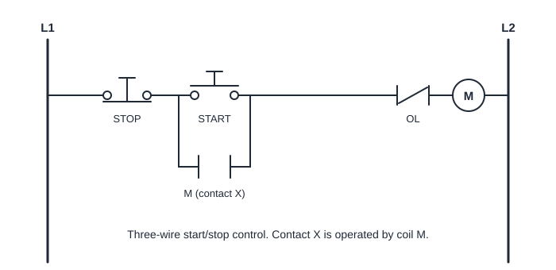

<!-- nav:top -->[Contents](../../README.md#contents) · Previous: [Mechanical maintenance and shop tools](maintenance-shop-tools.md) · Next: [Electronics, PLCs and test instruments](electronics-plc-instruments.md)<!-- /nav:top -->

# Motors, control circuits and schematics

**In one line:** you read motor control ladder diagrams, know how AC motors start, stop, reverse and protect themselves, and can find the fault when one will not run.

This is a MultiCraft category. MultiCrafTest and MultiCraft Trainee list it as "Motors, Control Circuits, and Schematics & Print Reading". MecTest does not list it, so skip this page if you are sitting MecTest or Mechanical Maintenance Trainee only.

## What it measures

Multicraft technicians are expected to fix the electrical side of a machine as well as the mechanical side. This category checks:

- **Ladder diagrams.** Reading a three-wire start/stop circuit, holding (seal-in) contacts, interlocks and overloads.
- **Motor basics.** Synchronous speed, slip, nameplate data, reversing a three-phase motor.
- **Starters and drives.** Contactors, overload relays, variable frequency drives.
- **Fault finding.** Why a motor hums, trips or will not start.

## How the questions look

Four-option multiple choice. Some items show a ladder diagram and ask what a contact does or what happens when a button is pressed. Others are short knowledge items about motors and starters.

## A method that works

1. **Read a ladder diagram rung by rung, left to right.** Power flows from the left rail (L1) through contacts to a load on the right (L2).
2. **Mark each contact NO or NC** in its resting (de-energised) state before you think about what happens.
3. **Follow one event at a time.** Press START: which coil energises? Which of its contacts change? Release START: is there still a path?
4. **For speed, use 120 x frequency / poles.** That gives synchronous speed. Induction motors run a little slower because of slip.
5. **For faults, ask "what does the motor need to run?"** All three phases, a closed control circuit, no tripped overload, and a load it can turn.

## Traps that cost points

- **Forgetting the holding contact.** Without it the motor runs only while you hold START.
- **Thinking an overload relay protects against short circuits.** It trips on sustained overcurrent. Fuses and breakers handle short circuits.
- **Swapping all three leads to reverse.** Swapping all three keeps the same rotation. Swap any two.
- **Using nameplate speed as synchronous speed.** 1,750 rpm on the plate means a 4-pole motor with 1,800 rpm synchronous speed.
- **Reading a symbol in its operated state.** Contacts are drawn as they are with no power and nothing pressed.

## Timing

Ladder items: 45 seconds to a minute. Knowledge items: 20 to 30 seconds.

## Practice items

These items are original, written for these notes. They are not taken from any Ramsay test.

**Item 1.** In the circuit above, what is the job of contact X?

- A. It stops the motor if it overheats
- B. It keeps coil M energised after START is released
- C. It reverses the motor
- D. It limits starting current

**Item 2.** The motor is running. STOP is pressed and then released. What happens?

- A. The motor stops and stays stopped
- B. The motor stops, then restarts when STOP is released
- C. The motor keeps running
- D. The overload trips

**Item 3.** How do you reverse the rotation of a three-phase induction motor?

- A. Swap all three supply leads
- B. Swap any two of the three supply leads
- C. Reverse the neutral connection
- D. Lower the supply frequency

**Item 4.** What is the synchronous speed of a 4-pole motor on a 60 Hz supply?

- A. 900 rpm
- B. 1,200 rpm
- C. 1,800 rpm
- D. 3,600 rpm

**Item 5.** A three-phase motor hums loudly but will not start, and soon trips. What is the most likely cause?

- A. One supply phase is open
- B. The supply voltage is slightly high
- C. The motor is too lightly loaded
- D. The rotation is wrong

Answers and explanations, items 1 to 5

**Item 1: B.** X is a normally open contact worked by coil M and wired in parallel with START. Once M pulls in, X closes and keeps current flowing to the coil after START springs open. This is the holding or seal-in contact. *Why not A:* overheating protection is the OL contact.

**Item 2: A.** STOP breaks the circuit, so M drops out and X opens. When STOP is released, START and X are both open, so there is no path to the coil. *Why not B:* restarting would need X to stay closed, but X opened the moment M dropped out.

**Item 3: B.** Swapping any two phases reverses the rotating magnetic field, so the motor turns the other way. *Why not A:* swapping all three shifts each phase along one place, which keeps the same phase sequence and the same rotation.

**Item 4: C, 1,800 rpm.** Synchronous speed = 120 x 60 / 4 = 1,800 rpm. The motor itself will run a little slower, around 1,750 rpm, because of slip. *Why not D:* 3,600 rpm is the 2-pole speed.

**Item 5: A.** With one phase lost (single phasing), a stopped three-phase motor has no rotating field to start it, so it hums, draws high current and trips. *Why not C:* a light load makes starting easier, not harder.

Want more? The [free timed Ramsay Maintenance practice test on PrepClubs](https://prepclubs.com/free-practice-tests/ramsay-maintenance?utm_source=github&utm_medium=referral&utm_campaign=study-notes&utm_content=ramsay-maintenance) has the full 60 questions, scored by area, in the MecTest style. MultiCraft-style forms with motors, electronics and AC/DC theory are there too.

## Score yourself

| Item | 1 | 2 | 3 | 4 | 5 |
|---|---|---|---|---|---|
| Answer | B | A | B | C | A |

- **5:** strong. Move on.
- **3 to 4:** trace the start/stop circuit again, one event at a time, until you can explain it out loud.
- **2 or fewer:** start with a basic motor controls text on ladder logic, then return to this page.

## Next step

Try control circuit items in a full timed run with the [free Ramsay Maintenance practice test on PrepClubs](https://prepclubs.com/free-practice-tests/ramsay-maintenance?utm_source=github&utm_medium=referral&utm_campaign=study-notes&utm_content=ramsay-maintenance).

---

<!-- nav:bottom -->← Previous: [Mechanical maintenance and shop tools](maintenance-shop-tools.md) | Next: [Electronics, PLCs and test instruments](electronics-plc-instruments.md) → | [Back to contents](../../README.md#contents)<!-- /nav:bottom -->
