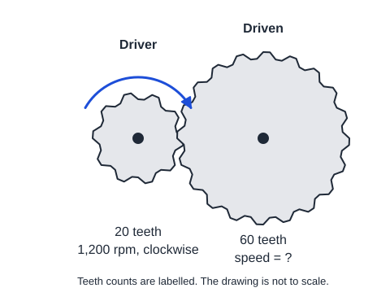
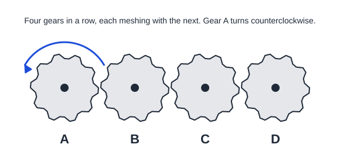
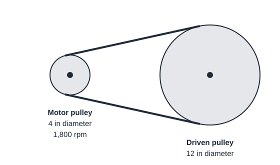
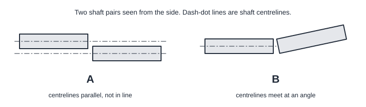

<!-- nav:top -->
[Contents](../../README.md#contents) · Previous: [Welding and rigging](welding-rigging.md) · Next: [Pumps, piping and combustion](pumps-piping.md)
<!-- /nav:top -->

# Power transmission and lubrication

**In one line:** you work out speeds, directions and torque through gears, belts and chains, spot misalignment, and know how to lubricate bearings without killing them.

Power transmission and lubrication appear on every Ramsay form covered here. MecTest lists them as two categories, Power Transmission and Lubrication. Mechanical Maintenance Trainee combines them. The MultiCraft forms fold them into one wider category with mechanical maintenance and shop equipment.

## What it measures

Most plant breakdowns are mechanical drive failures: a belt slipping, a chain stretched, a bearing running hot, a coupling out of line. This category checks you can reason about drives and keep them lubricated:

- **Ratios.** Speed and direction through gear trains, belts and chains.
- **Torque and speed trade-off.** Slowing a shaft down raises its torque, ignoring losses.
- **Alignment.** Parallel (offset) and angular misalignment, and what a dial indicator shows.
- **Lubrication.** Oil and grease basics, viscosity, and the cost of too much grease.

## How the questions look

Four-option multiple choice. Gear and belt items usually give tooth counts, diameters or speeds and ask for one unknown. Direction items show a row of gears. Lubrication items are short knowledge questions.

## A method that works

1. **For speed, use driver x driver size = driven x driven size.** Size means teeth for gears and sprockets, diameter for pulleys.
2. **Sanity check the direction of change.** A small gear driving a big gear slows down. A big gear driving a small one speeds up.
3. **For direction, count the meshes.** Each external mesh reverses rotation. In a straight row, odd-numbered gears turn the same way as the first.
4. **Belts do not reverse.** An open belt keeps both pulleys turning the same way. A crossed belt reverses.
5. **Torque goes the opposite way to speed.** Slow the shaft by 3 times and you have about 3 times the torque.

## Traps that cost points

- **Inverting the ratio.** If a small gear drives a big one and your answer is faster, flip it.
- **Thinking gear size changes direction.** Only the number of meshes matters for direction. An idler gear changes direction but not the overall ratio.
- **Assuming more grease is better.** Packing a fast bearing full makes it churn and run hot. Follow the quantity and interval.
- **Mixing up the misalignment types.** Parallel (offset): centrelines parallel but not in line. Angular: centrelines meet at an angle.
- **Forgetting viscosity drops as oil heats.** Hot oil is thinner. That is why oil grade is chosen for the running temperature.

## Timing

Ratio and direction items: 30 to 45 seconds once the method is automatic. Lubrication knowledge items: 20 to 30 seconds.

## Practice items

These items are original, written for these notes. They are not taken from any Ramsay test.

**Item 1.** The 20-tooth driver turns at 1,200 rpm. How fast does the 60-tooth driven gear turn?

- A. 400 rpm
- B. 600 rpm
- C. 1,200 rpm
- D. 3,600 rpm

**Item 2.** Gear A turns counterclockwise. Which way does gear D turn?

- A. Clockwise
- B. Counterclockwise
- C. It cannot turn, the train is locked
- D. It depends on the gear sizes

**Item 3.** How fast does the 12-inch driven pulley turn?

- A. 450 rpm
- B. 600 rpm
- C. 1,800 rpm
- D. 5,400 rpm

**Item 4.** Which drawing above shows angular misalignment?

- A. A
- B. B
- C. Both
- D. Neither

**Item 5.** A high-speed ball bearing is packed completely full of grease. What is the most likely result?

- A. It runs hot
- B. It rusts
- C. It runs cooler than normal
- D. It lasts longer between services

Answers and explanations, items 1 to 5

**Item 1: A, 400 rpm.** 1,200 x 20 = driven speed x 60, so driven speed = 24,000 / 60 = 400 rpm. A small gear driving a big one slows down. *Why not D:* 3,600 rpm inverts the ratio.

**Item 2: A, clockwise.** A counterclockwise, B clockwise, C counterclockwise, D clockwise. Each mesh reverses direction. *Why not C:* gears in a single row lock only when they form a closed loop with an odd number of gears. This is a straight row.

**Item 3: B, 600 rpm.** 1,800 x 4 = driven speed x 12, so driven speed = 7,200 / 12 = 600 rpm. *Why not D:* 5,400 rpm treats the big pulley as the driver.

**Item 4: B.** In B the shaft centrelines meet at an angle. In A they are parallel but offset, which is parallel (offset) misalignment. *Why not C:* both are misalignment, but only B is angular.

**Item 5: A.** Too much grease churns inside the bearing, creating friction and heat, and can push out the seals. *Why not D:* overgreasing shortens bearing life.

Want more? The [free timed Ramsay Maintenance practice test on PrepClubs](https://prepclubs.com/free-practice-tests/ramsay-maintenance?utm_source=github&utm_medium=referral&utm_campaign=study-notes&utm_content=ramsay-maintenance) has the full 60 questions, scored by area.

## Score yourself

| Item | 1 | 2 | 3 | 4 | 5 |
|---|---|---|---|---|---|
| Answer | A | A | B | B | A |

- **5:** solid. Keep the ratio formula fresh with a few mixed items.
- **3 to 4:** redo the ratio items with the "sanity check" step and relearn the two misalignment types.
- **2 or fewer:** write out driver x size = driven x size and work each ratio item twice, once each way, until the direction of change feels obvious.

## Next step

Practise gear and belt items at speed in the [free Ramsay Maintenance practice test on PrepClubs](https://prepclubs.com/free-practice-tests/ramsay-maintenance?utm_source=github&utm_medium=referral&utm_campaign=study-notes&utm_content=ramsay-maintenance).

---

<!-- nav:bottom -->
← Previous: [Welding and rigging](welding-rigging.md) | Next: [Pumps, piping and combustion](pumps-piping.md) → | [Back to contents](../../README.md#contents)
<!-- /nav:bottom -->
