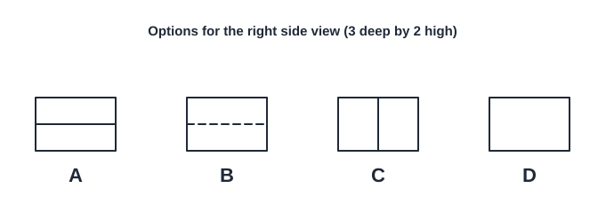

<!-- nav:top -->
[Contents](../../README.md#contents) · Previous: [Pumps, piping and combustion](pumps-piping.md) · Next: [Mechanical maintenance and shop tools](maintenance-shop-tools.md)
<!-- /nav:top -->

# Print reading

**In one line:** you read mechanical drawings: line types, views, dimensions, tolerances and the common callouts on a shop print.

Print Reading is a category on MecTest and Mechanical Maintenance Trainee. On the MultiCraft forms it sits inside "Motors, Control Circuits, and Schematics & Print Reading", so MultiCraft candidates also need electrical schematics, covered on the [motors and controls](motors-controls.md) page. This page covers the mechanical side.

## What it measures

Whether you can make or fit a part from a drawing without asking someone to explain it. That means:

- **Line types.** Visible, hidden, centre and dimension lines each mean something different.
- **Views.** Front, top and side views, and how they line up in a multiview drawing.
- **Dimensions.** Adding and subtracting chained dimensions to find one that is not shown.
- **Tolerances and callouts.** Limits, diameters, thread callouts and section views.

## How the questions look

Four-option multiple choice, often with a small drawing. Common tasks: name a line type, pick the missing view, find a missing dimension, or decide whether a measured part is within tolerance.

## A method that works

1. **Read the notes and title block first.** Units, scale and projection method change the answer.
2. **For a missing dimension, write the chain.** Overall length minus the known pieces gives the missing one.
3. **For tolerances, work out both limits** before you look at the options. Treat the limits as inside the tolerance.
4. **For views, picture yourself standing where the view is taken from.** Edges you can see are solid. Edges behind material are dashed.
5. **Check the projection.** In third-angle projection (US practice) the top view is above the front view and the right side view is to the right.

## Traps that cost points

- **Measuring the drawing with a rule.** Prints are often not to scale. Use the dimensions given.
- **Reading a hidden line as a visible edge.** Short dashes mean the edge is there but behind material.
- **Dropping a decimal place in tolerances.** 2.500 ±0.005 runs from 2.495 to 2.505, not 2.45 to 2.55.
- **Mixing up radius and diameter.** R is radius. Ø is diameter, twice the radius.
- **Misreading thread callouts.** In 1/2-13 UNC, the 13 is threads per inch, not a length.

## Timing

Line-type and callout items: 20 to 30 seconds. Dimension chains: 30 to 45 seconds. View items: up to a minute, so do them last if you are short of time.

## Practice items

These items are original, written for these notes. They are not taken from any Ramsay test.

**Item 1.** Which line above is a hidden line?

- A. A
- B. B
- C. C
- D. D

**Item 2.** What is dimension X?

- A. 3.75
- B. 4.25
- C. 5.75
- D. 6.50

**Item 3.** A print gives a shaft diameter as 2.500 ±0.005. Which measured shaft is out of tolerance?

- A. 2.496
- B. 2.500
- C. 2.505
- D. 2.494

**Item 4.** The first drawing shows the front and top views of a stepped block. Which option is the correct right side view?

- A. A
- B. B
- C. C
- D. D

**Item 5.** A hole is called out as "1/2-13 UNC". What does the 13 mean?

- A. The hole is 13 mm deep
- B. 13 threads per inch
- C. Thread class 13
- D. A thread pitch of 13 mm

Answers and explanations, items 1 to 5

**Item 1: B.** Evenly spaced short dashes mark a hidden line: an edge that exists but is behind material in this view. *Why not C:* C alternates long and short dashes, which marks a centre line.

**Item 2: B, 4.25.** The right-hand hole is 1.50 + 2.25 = 3.75 from the left edge. 8.00 - 3.75 = 4.25. *Why not A:* 3.75 is the distance from the left edge, not to the right edge.

**Item 3: D, 2.494.** The limits are 2.495 and 2.505. Only 2.494 falls outside. *Why not C:* 2.505 is exactly on the upper limit, which is allowed.

**Item 4: A.** From the right you see the 3-deep by 2-high outline. The low step sits in front, so the edge where the step's top surface meets the tall part shows as a solid (visible) line at height 1. *Why not B:* that edge is not behind any material from this direction, so it is not hidden. *Why not D:* the step edge must appear somewhere; a plain rectangle leaves it out.

**Item 5: B.** In Unified thread callouts, the first number is the nominal diameter (1/2 inch) and the second is threads per inch. *Why not D:* inch threads are given in threads per inch, not a pitch in millimetres.

Want more? The [free timed Ramsay Maintenance practice test on PrepClubs](https://prepclubs.com/free-practice-tests/ramsay-maintenance?utm_source=github&utm_medium=referral&utm_campaign=5q2ftk&utm_content=ramsay-maintenance) has the full 60 questions, scored by area.

## Score yourself

| Item | 1 | 2 | 3 | 4 | 5 |
|---|---|---|---|---|---|
| Answer | B | B | D | A | B |

- **5:** strong. Keep views fresh by sketching a side view of anything on your desk.
- **3 to 4:** relearn the line types and redo the tolerance and dimension chain items.
- **2 or fewer:** work through a basic blueprint reading book chapter on views and lines, then redo all 5 items.

## Next step

Practise print items under time pressure in the [free Ramsay Maintenance practice test on PrepClubs](https://prepclubs.com/free-practice-tests/ramsay-maintenance?utm_source=github&utm_medium=referral&utm_campaign=5q2ftk&utm_content=ramsay-maintenance).

---

<!-- nav:bottom -->
← Previous: [Pumps, piping and combustion](pumps-piping.md) | Next: [Mechanical maintenance and shop tools](maintenance-shop-tools.md) → | [Back to contents](../../README.md#contents)
<!-- /nav:bottom -->
