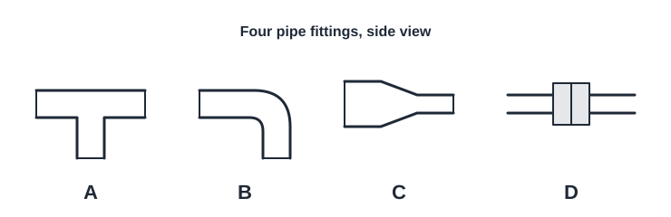

<!-- nav:top -->
[Contents](../../README.md#contents) · Previous: [Power transmission and lubrication](power-transmission-lubrication.md) · Next: [Print reading](print-reading.md)
<!-- /nav:top -->

# Pumps, piping and combustion

**In one line:** you know how centrifugal and positive displacement pumps work and fail, which valves and fittings do what, and the basics of a clean burner flame.

MecTest and Mechanical Maintenance Trainee list "Pumps & Piping" as a category. The MultiCraft forms list "Pumps, Piping, and Combustion", so burners and combustion air are worth reviewing if you are sitting MultiCrafTest or MultiCraft Trainee.

## What it measures

Pumps move water, coolant, chemicals and fuel around every plant. When one fails, maintenance gets the call. This category checks you can:

- **Name pump parts** and explain what each does.
- **Tell the two pump families apart.** Centrifugal pumps move a variable flow against pressure. Positive displacement pumps move a fixed volume per turn whatever the pressure.
- **Diagnose common faults** such as cavitation, loss of prime and overheating.
- **Choose valves and fittings** for isolating, throttling, preventing backflow and changing pipe size.
- **Read a flame** and know what complete combustion needs (MultiCraft forms).

## How the questions look

Four-option multiple choice. You may see a pump cutaway to label, a set of fittings to identify, or a short fault description to diagnose.

## A method that works

1. **Decide which pump family the question is about.** Many answers flip between centrifugal and positive displacement.
2. **For faults, start at the suction side.** Most pump trouble begins before the pump: low level, a clogged strainer, an air leak, a throttled suction valve.
3. **For valves, ask what the job is.** Isolate (gate or ball), throttle (globe), stop backflow (check).
4. **For fittings, ask what changes.** Direction (elbow), branch (tee), size (reducer), or the ability to take it apart (union).
5. **For combustion, think fuel, air and mixing.** A clean blue flame needs enough air, well mixed.

## Traps that cost points

- **Throttling on the suction side of a centrifugal pump.** It starves the pump and causes cavitation. Throttle the discharge.
- **Running a positive displacement pump against a closed valve.** It keeps pushing the same volume, so pressure climbs until something gives. It needs a relief valve.
- **Using a gate valve to throttle.** A part-open gate valve chatters and erodes. Gate valves are for fully open or fully closed.
- **Forgetting a centrifugal pump must be primed.** It cannot pump air.
- **Calling a yellow, lazy flame "rich in air".** It is short of air.

## Timing

Most items are knowledge items, 20 to 40 seconds each. Diagram items: up to a minute.

## Practice items

These items are original, written for these notes. They are not taken from any Ramsay test.

**Item 1.** On a centrifugal pump, which valve should never be used to throttle flow?

- A. The suction valve
- B. The discharge valve
- C. A globe valve in the discharge line
- D. A recirculation valve

**Item 2.** Why must a gear pump (a positive displacement pump) have a relief valve in its discharge?

- A. It moves a fixed volume per turn, so a blocked outlet makes pressure rise until something fails
- B. It cannot start without one
- C. It needs the relief valve to prime itself
- D. The relief valve controls its speed

**Item 3.** Which fitting above lets you take a threaded pipe run apart without turning the pipe?

- A. A
- B. B
- C. C
- D. D

**Item 4.** Which valve type is best suited to throttling flow?

- A. Gate valve
- B. Globe valve
- C. Swing check valve
- D. Full-port ball valve used for isolation

**Item 5.** A gas burner has a yellow, lazy flame that leaves soot. What is the most likely cause?

- A. Not enough combustion air
- B. Too much combustion air
- C. Gas pressure far too high for the burner
- D. The pilot light is too large

Answers and explanations, items 1 to 5

**Item 1: A.** Throttling the suction starves the pump and invites cavitation. Flow is controlled on the discharge side. *Why not C:* a globe valve on the discharge is a normal way to throttle.

**Item 2: A.** A positive displacement pump pushes the same volume each turn whatever the resistance. With the outlet blocked, pressure rises until a seal, pipe, pump or motor fails. The relief valve gives that flow a safe path. *Why not B:* the pump starts fine without one, which is exactly what makes a blocked outlet dangerous.

**Item 3: D.** D is a union: two halves joined by a nut, so you can split the run by turning the nut alone. *Why not B:* an elbow changes direction, and you would have to turn the pipe to remove it.

**Item 4: B.** A globe valve's disc moves straight onto its seat, which gives fine, stable control of flow. *Why not A:* a gate valve is meant to be fully open or fully closed. Part open, the gate chatters and the seats erode.

**Item 5: A.** A yellow, sooty flame means the fuel is not getting enough air to burn completely. *Why not B:* too much air tends to give a short, harsh, sometimes lifting flame, not a lazy yellow one.

Want more? The [free timed Ramsay Maintenance practice test on PrepClubs](https://prepclubs.com/free-practice-tests/ramsay-maintenance?utm_source=github&utm_medium=referral&utm_campaign=study-notes&utm_content=ramsay-maintenance) has the full 60 questions, scored by area.

## Score yourself

| Item | 1 | 2 | 3 | 4 | 5 |
|---|---|---|---|---|---|
| Answer | A | A | D | B | A |

- **5:** strong. Move on.
- **3 to 4:** review the two pump families and the "what is the job" valve rule.
- **2 or fewer:** start with the method list and the traps, then redo every item without looking at the answers.

## Next step

Mix pump and piping items with the other categories in the [free Ramsay Maintenance practice test on PrepClubs](https://prepclubs.com/free-practice-tests/ramsay-maintenance?utm_source=github&utm_medium=referral&utm_campaign=study-notes&utm_content=ramsay-maintenance).

---

<!-- nav:bottom -->
← Previous: [Power transmission and lubrication](power-transmission-lubrication.md) | Next: [Print reading](print-reading.md) → | [Back to contents](../../README.md#contents)
<!-- /nav:bottom -->
