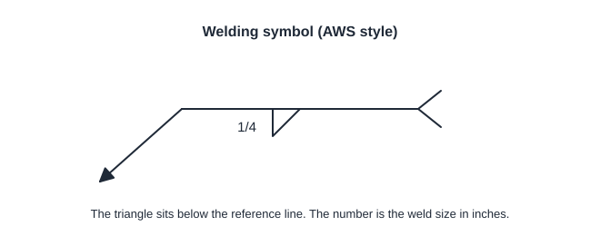
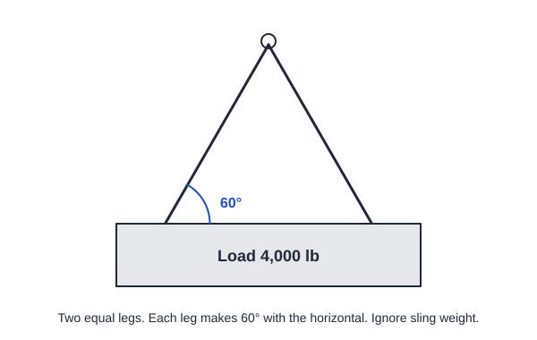
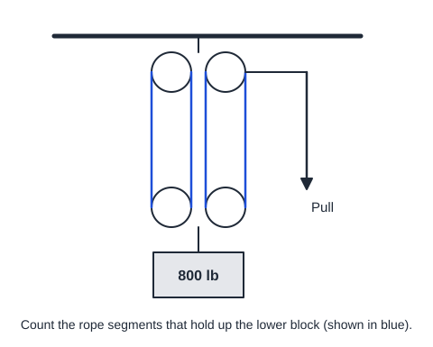

<!-- nav:top -->
[Contents](../../README.md#contents) · Previous: [Hydraulics and pneumatics](hydraulics-pneumatics.md) · Next: [Power transmission and lubrication](power-transmission-lubrication.md)
<!-- /nav:top -->

# Welding and rigging

**In one line:** you show you can read a welding symbol, pick the right process and consumable, and rig a load safely, including the sling and pulley sums.

Ramsay lists "Welding & Rigging" as a category on MecTest and Mechanical Maintenance Trainee, and "Welding, Cutting, and Rigging" on MultiCraft Trainee. MultiCrafTest lists "Welding and Rigging". So cutting (oxy-fuel and similar) is worth a look if you are sitting a MultiCraft form.

## What it measures

Maintenance mechanics weld brackets, repair guards, cut out seized parts and lift motors and gearboxes. The test checks that you know enough to do that safely and to the drawing:

- **Welding processes and consumables.** What SMAW, GMAW and GTAW mean, and what an electrode code tells you.
- **Welding symbols.** Which side of the joint, what type of weld, what size.
- **Cutting and gas safety.** Acetylene and oxygen handling.
- **Rigging.** Sling angles, block-and-tackle advantage, and when a sling or wire rope must be taken out of service.

## How the questions look

Four-option multiple choice. Expect a mix of straight knowledge items, a symbol to decode, and rigging sums that need one multiplication or division. Rigging sums in these notes use simple angles (30, 45 and 60 degrees) so you can work them without a calculator if you know the values below.

| Angle from horizontal | sin of angle | Leg tension multiplier (1 / sin) |
|---|---|---|
| 90° (vertical) | 1.000 | 1.000 |
| 60° | 0.866 | 1.155 |
| 45° | 0.707 | 1.414 |
| 30° | 0.500 | 2.000 |

## A method that works

1. **For welding symbols, find the reference line first.** Below the line means the arrow side. Above means the other side. Symbols on both sides mean both sides.
2. **Read the size to the left of the weld symbol,** and the length (if any) to the right.
3. **For sling tension, split the load between the legs,** then multiply by the factor for the angle. Legs at 60° from horizontal each carry about 1.155 times their share.
4. **For a block and tackle, count the rope parts holding up the moving block.** Ideal pull is load divided by that number. Rope pulled is lift distance times that number.
5. **For safety items, pick the option that removes the hazard,** not the one that saves time.

## Traps that cost points

- **Mixing up arrow side and other side.** It is the position relative to the reference line that counts, not which way the arrow points.
- **Ignoring sling angle.** Lower angles (flatter slings) raise the tension in each leg sharply. At 30° from horizontal, each leg carries the full load.
- **Counting the pull line as a supporting part** when it comes off the fixed block. Only parts that hold up the moving block count.
- **Treating GTAW as a wire-feed process.** GTAW (TIG) uses a non-consumable tungsten electrode. GMAW (MIG) feeds consumable wire.
- **Running acetylene at high pressure.** Acetylene becomes unstable above 15 psi gauge. Every regulator setting question hangs on that number.

## Timing

Symbol and process items: about 30 seconds. Sling and block sums: up to a minute. Memorise the table above and the sling items become quick.

## Practice items

These items are original, written for these notes. They are not taken from any Ramsay test.

**Item 1.** What weld does the symbol above call for?

- A. A fillet weld on the arrow side of the joint
- B. A fillet weld on the other side of the joint
- C. A groove weld on the arrow side of the joint
- D. Fillet welds on both sides of the joint

**Item 2.** At what gauge pressure should acetylene never be used?

- A. Above 5 psi
- B. Above 15 psi
- C. Above 50 psi
- D. Above 100 psi

**Item 3.** In the lift above, about how much tension is in each sling leg?

- A. 2,000 lb
- B. 2,310 lb
- C. 3,460 lb
- D. 4,000 lb

**Item 4.** The same 4,000 lb load is rigged with shorter slings, so each leg is now at 30° from horizontal. About how much tension is in each leg?

- A. 2,000 lb
- B. 2,310 lb
- C. 4,000 lb
- D. 8,000 lb

**Item 5.** Ignoring friction and the weight of the blocks, what pull is needed to hold the 800 lb load?

- A. 100 lb
- B. 200 lb
- C. 400 lb
- D. 800 lb

Answers and explanations, items 1 to 5

**Item 1: A.** The triangle is the fillet weld symbol, and it sits below the reference line, which means the arrow side. *Why not B:* a fillet on the other side would sit above the line.

**Item 2: B.** Acetylene can decompose violently above about 15 psi gauge, so regulators are never set higher. *Why not A:* 5 psi is a common working setting, well inside the limit, not the limit itself.

**Item 3: B, about 2,310 lb.** Each leg takes half the load, 2,000 lb, multiplied by 1 / sin 60° = 1.155. 2,000 x 1.155 = 2,310 lb. *Why not A:* 2,000 lb would be right only if the legs hung straight down.

**Item 4: C, 4,000 lb.** At 30° the multiplier is 2: 2,000 x 2 = 4,000 lb in each leg. That is why flat sling angles are dangerous. *Why not B:* that is the 60° answer from item 3.

**Item 5: B, 200 lb.** Four rope parts hold up the moving block, so each carries 800 / 4 = 200 lb, and that is the pull. *Why not C:* 400 lb would come from counting only two supporting parts.

Want more? The [free timed Ramsay Maintenance practice test on PrepClubs](https://prepclubs.com/free-practice-tests/ramsay-maintenance?utm_source=github&utm_medium=referral&utm_campaign=study-notes&utm_content=ramsay-maintenance) has the full 60 questions, scored by area.

## Score yourself

| Item | 1 | 2 | 3 | 4 | 5 |
|---|---|---|---|---|---|
| Answer | A | B | B | C | B |

- **5:** strong. Spend your time on weaker categories.
- **3 to 4:** relearn the reference line rule and the angle table, then redo items 1, 3 and 4.
- **2 or fewer:** go through the method steps one at a time. Most misses here are rule misses, not knowledge gaps.

## Next step

Put the sling and symbol rules under time pressure with the [free Ramsay Maintenance practice test on PrepClubs](https://prepclubs.com/free-practice-tests/ramsay-maintenance?utm_source=github&utm_medium=referral&utm_campaign=study-notes&utm_content=ramsay-maintenance).

---

<!-- nav:bottom -->
← Previous: [Hydraulics and pneumatics](hydraulics-pneumatics.md) | Next: [Power transmission and lubrication](power-transmission-lubrication.md) → | [Back to contents](../../README.md#contents)
<!-- /nav:bottom -->
